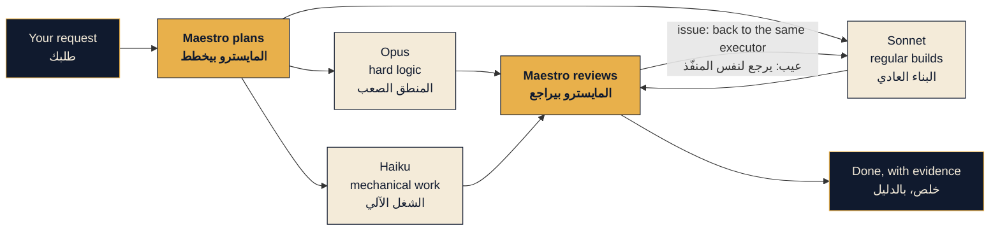

<p align="center">

</p>

<p align="center">
<a href="LICENSE"></a>
<a href="https://github.com/aezzatelashry/maestro/releases/latest"></a>
<a href="https://code.claude.com"></a>
</p>

<p align="center">
Cost-aware multi-model orchestration for Claude Code<br>
توزيع الشغل على الموديلات حسب التكلفة في Claude Code
</p>

<table>
<tr>
<th width="50%">English</th>
<th width="50%" dir="rtl">العربية</th>
</tr>
<tr>
<td valign="top">

**Maestro** is a Claude Code plugin. The strongest model you have (Fable, or Opus when Fable is not available) plans, directs and reviews, and smaller models (Opus, Sonnet, Haiku) do the building. Each task goes to the smallest model that does it well.

Most implementation work does not need the most expensive model. Review and judgment do. Maestro keeps the two apart.

</td>
<td valign="top" dir="rtl">

**المايسترو** plugin لـ Claude Code. أقوى موديل متاح عندك (Fable، أو Opus لو Fable مش موجود) بيخطط ويوجّه ويراجع، والموديلات الأصغر (Opus وSonnet وHaiku) بتنفّذ. كل مهمة بتروح لأصغر موديل يعملها صح.

أغلب شغل التنفيذ ما يحتاجش أغلى موديل، لكن المراجعة والقرار محتاجينه. المايسترو بيفصل بينهم.

</td>
</tr>
</table>

## How it works · إزاي بيشتغل



## What it does · بيعمل إيه

<table>
<tr>
<td width="50%" valign="top">

- **Sizes the request** (small, medium, large or sensitive). The size decides which steps run, so a small edit does not get a full plan.
- **Writes a plan** as a task table: model, files, skills and the evidence that proves each task is done.
- **Routes by kind of work**, and tunes the routing over time from a log of real outcomes.
- **Writes a complete brief** for every executor, since the executor knows only what the brief says.
- **Reviews the work itself.** An executor's report is not evidence: Maestro reads the diff and runs the checks.
- **For large work**, writes a pre-mortem before dispatch and sends the result to an independent reviewer with a fresh context.
- **Has run limits.** If a task still fails after moving to a bigger model, or the plan grows too much, it stops and asks you.
- **Keeps state** in `docs/STATUS.md`, so a new session picks up where the last one stopped.
- **Handles documents too:** tender responses, submittals, project reports, decks and BOQs. Every figure is traced to its source, and nothing is invented.
- **Learns.** Lessons and the run log live in `~/.claude/maestro/`, outside the plugin, so updates do not erase them.

</td>
<td width="50%" valign="top" dir="rtl">

- **بيحدد حجم الطلب** (صغير، متوسط، كبير أو حساس). الحجم بيقرر الخطوات، فالتعديل الصغير ما ياخدش خطة كاملة.
- **بيكتب خطة** بجدول مهام: الموديل، والملفات، والمهارات، والدليل اللي يثبت إن كل مهمة خلصت.
- **بيختار الموديل حسب نوع الشغل**، وبيضبط الاختيار مع الوقت من سجل النتائج الفعلية.
- **بيكتب بريف كامل** لكل منفّذ، لأن المنفّذ ما يعرفش غير اللي في البريف.
- **بيراجع بنفسه.** تقرير المنفّذ مش دليل: المايسترو بيقرا الـ diff ويشغّل الدليل.
- **في الشغل الكبير** بيكتب تحليل للفشل قبل التوزيع، وبيبعت الناتج لمراجع مستقل بسياق جديد.
- **عنده حدود للتشغيل.** لو المهمة فشلت بعد رفع الموديل، أو الخطة كبرت زيادة، بيوقف ويسألك.
- **بيحفظ الحالة** في `docs/STATUS.md`، فأي جلسة جديدة تكمّل من نفس النقطة.
- **بيشتغل على المستندات كمان:** مناقصات، وsubmittals، وتقارير مشاريع، وعروض، وBOQ. كل رقم ليه مصدر، ومفيش حاجة بتتألّف.
- **بيتعلّم.** الدروس والسجل بيتحفظوا في `~/.claude/maestro/`، برا الـ plugin، فما بيضيعوش مع التحديث.

</td>
</tr>
</table>

## Requirements · المتطلبات

<table>
<tr>
<td width="50%" valign="top">

- Claude Code, because Maestro relies on the `Agent` and `SendMessage` tools and on worktrees.
- Works best with Fable for planning. Without it, Opus takes that role.

</td>
<td width="50%" valign="top" dir="rtl">

- Claude Code، لأن المايسترو بيعتمد على أدوات `Agent` و`SendMessage` والـ worktrees.
- أحسن مع Fable للتخطيط. من غيره، Opus بياخد الدور ده.

</td>
</tr>
</table>

## Install · التركيب

Two ways. Pick one, not both · طريقتين، اختار واحدة بس:

### A. As a plugin (recommended) · كـ plugin (المقترح)

Inside Claude Code · جوه Claude Code:

```
/plugin marketplace add aezzatelashry/maestro
/plugin install elashry-maestro@maestro
```

Update later · التحديث بعدين:

```
/plugin marketplace update maestro
```

Run · التشغيل: `/elashry-maestro:maestro`

### B. As a standalone skill · كـ skill لوحدها

<table>
<tr>
<td width="50%" valign="top">

The standalone skill is called **Elashry Pro Maestro-skill** (`elashry-pro-maestro-skill`). Download `elashry-pro-maestro-skill.zip` from the [latest release](https://github.com/aezzatelashry/maestro/releases/latest) and unzip it into `~/.claude/skills/`, or run the commands below.

To update, delete `~/.claude/skills/elashry-pro-maestro-skill` and repeat.

</td>
<td width="50%" valign="top" dir="rtl">

الـ skill اللي لوحدها اسمها **Elashry Pro Maestro-skill** (`elashry-pro-maestro-skill`). نزّل `elashry-pro-maestro-skill.zip` من [آخر release](https://github.com/aezzatelashry/maestro/releases/latest) وفكّه جوه `~/.claude/skills/`، أو شغّل الأوامر اللي تحت.

للتحديث، امسح `~/.claude/skills/elashry-pro-maestro-skill` وكرّر نفس الخطوات.

</td>
</tr>
</table>

macOS / Linux:

```bash
curl -L -o /tmp/elashry-pro-maestro-skill.zip https://github.com/aezzatelashry/maestro/releases/latest/download/elashry-pro-maestro-skill.zip
mkdir -p ~/.claude/skills && unzip -o /tmp/elashry-pro-maestro-skill.zip -d ~/.claude/skills
```

Windows (PowerShell):

```powershell
Invoke-WebRequest https://github.com/aezzatelashry/maestro/releases/latest/download/elashry-pro-maestro-skill.zip -OutFile "$env:TEMP\elashry-pro-maestro-skill.zip"
Expand-Archive "$env:TEMP\elashry-pro-maestro-skill.zip" "$HOME\.claude\skills" -Force
```

Run · التشغيل: `/elashry-pro-maestro-skill`

## Use · الاستخدام

Say "maestro" or «المايسترو», or run the command for the way you installed it · قول «المايسترو» أو "maestro"، أو شغّل الأمر حسب طريقة التركيب:

```
/elashry-maestro:maestro       # plugin
/elashry-pro-maestro-skill     # standalone skill
```

## Files · الملفات

| Path · المسار | Contents | المحتوى |
|---|---|---|
| `skills/maestro/SKILL.md` | Core rules | القواعد الأساسية |
| `skills/maestro/references/documents.md` | Document mode | شغل المستندات |
| `skills/maestro/references/evidence.md` | Evidence for each kind of task | الدليل لكل نوع مهمة |
| `skills/maestro/references/templates/` | Empty templates for lessons and the run log | قوالب فاضية للدروس والسجل |
| `examples/` | Fictional examples: feature plan, tender plan, executor brief, status file | أمثلة خيالية: خطة ميزة، وخطة مناقصة، وبريف لمنفّذ، وملف حالة |

## Your private files · ملفاتك الخاصة

<table>
<tr>
<td width="50%" valign="top">

On first run Maestro creates `~/.claude/maestro/` with:

- **`rules.md`:** your overrides, such as the model table, run limits and where your skill library lives.
- **`lessons.md`:** lessons from past runs.
- **`runs.md`:** a log of tasks, models and outcomes.

These files stay on your machine and are never uploaded.

</td>
<td width="50%" valign="top" dir="rtl">

في أول تشغيل، المايسترو بيعمل `~/.claude/maestro/` وفيه:

- **`rules.md`:** تعديلاتك، زي جدول الموديلات، وحدود التشغيل، ومكان مكتبة المهارات بتاعتك.
- **`lessons.md`:** دروس التشغيلات اللي فاتت.
- **`runs.md`:** سجل المهام والموديلات والنتائج.

الملفات دي بتفضل على جهازك، وما بتترفعش في أي مكان.

</td>
</tr>
</table>

## License · الترخيص

<table>
<tr>
<td width="50%" valign="top">

Copyright 2026 Ahmed Elashry. Licensed under the [Apache License 2.0](LICENSE).

You may use, change and share Maestro, including commercially. If you share a copy or a modified version, you must:

- include the [LICENSE](LICENSE) and [NOTICE](NOTICE) files, which carry the author's name;
- mark the files you changed.

</td>
<td width="50%" valign="top" dir="rtl">

حقوق النشر 2026 لـ أحمد عزت العشري (Ahmed Elashry). مرخّص بـ [Apache License 2.0](LICENSE).

تقدر تستخدم المايسترو وتعدّل عليه وتنشره، حتى للاستخدام التجاري. لو نشرت نسخة منه أو نسخة معدّلة، لازم:

- تحط معاها ملفات [LICENSE](LICENSE) و[NOTICE](NOTICE)، وفيهم اسم المؤلف؛
- توضّح الملفات اللي غيّرتها.

</td>
</tr>
</table>
